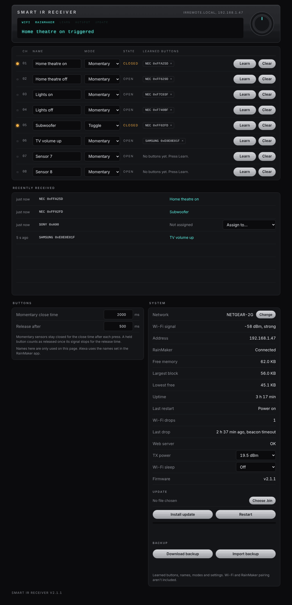
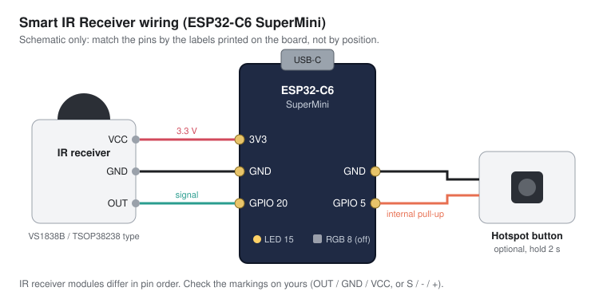
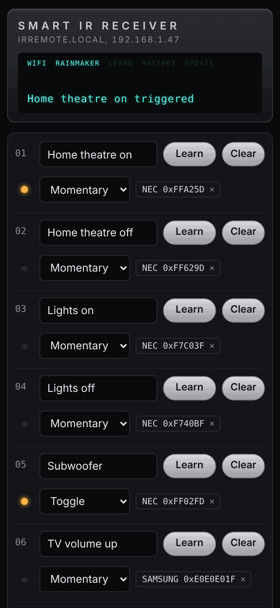
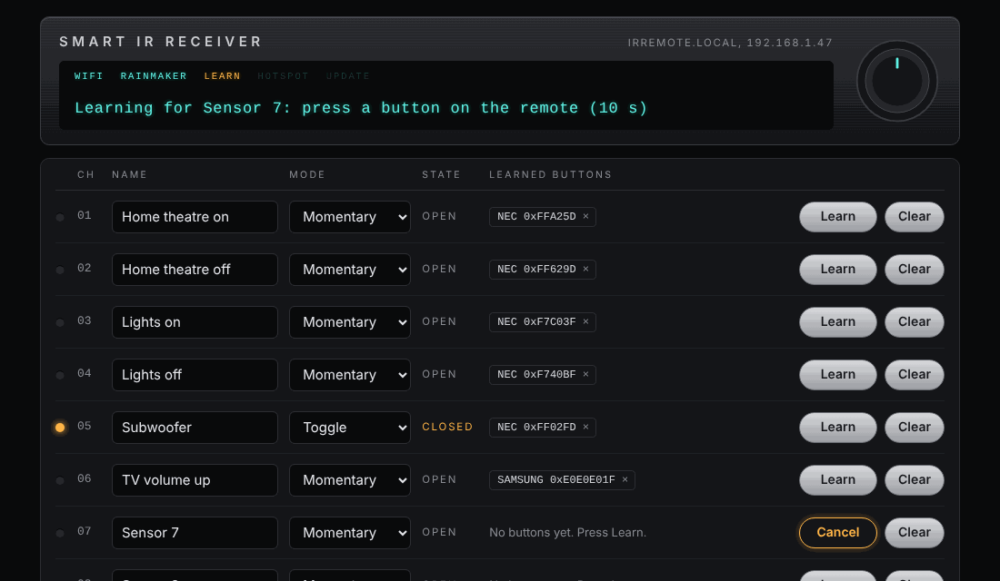
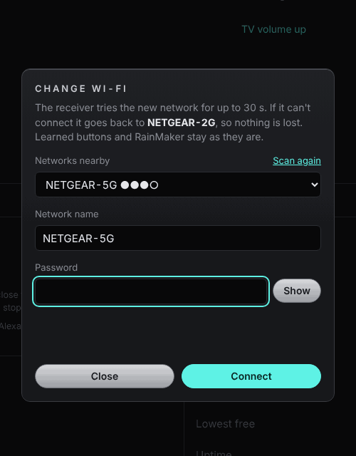
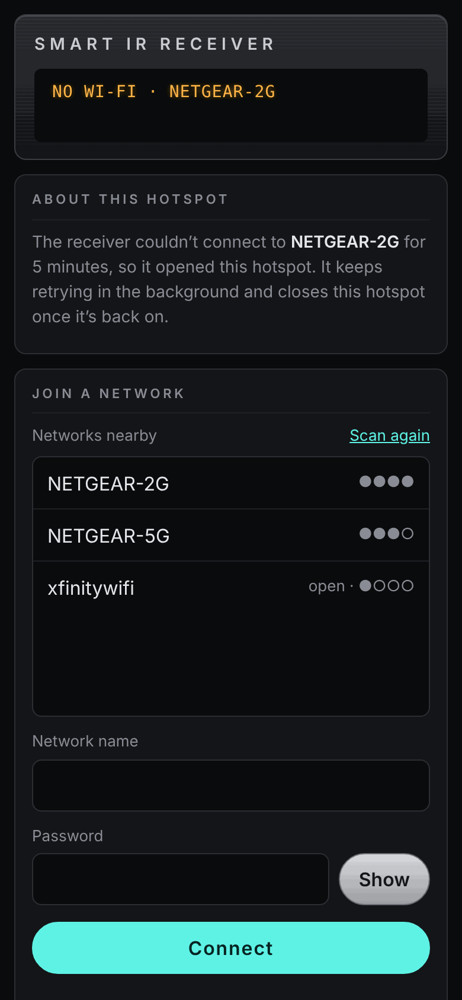

# Smart IR Receiver

Turn any IR remote into an Alexa trigger. An ESP32-C6 SuperMini listens for remote control buttons and reports each one to **ESP RainMaker** as one of eight contact sensors. Alexa routines fire when a sensor closes or opens, so a spare button on a TV, LED strip or kit remote can switch on the home theatre, dim the lights or toggle a subwoofer.

Buttons are taught from a **web console on the board**. Adding, moving or removing a button never needs new firmware.



**Current version: 2.1.1** · Board: ESP32-C6 SuperMini · Console: `http://irremote.local` · [Downloads](../../releases)

---

## Contents

- [How it works](#how-it-works)
- [Features](#features)
- [Hardware](#hardware)
- [Installing](#installing)
- [Setting up Alexa](#setting-up-alexa)
- [The web console](#the-web-console)
- [Teaching buttons](#teaching-buttons)
- [Wi-Fi and the setup hotspot](#wi-fi-and-the-setup-hotspot)
- [Status LED](#status-led)
- [Updating the firmware](#updating-the-firmware)
- [Backup and restore](#backup-and-restore)
- [Troubleshooting](#troubleshooting)
- [REST API](#rest-api)
- [Building from source](#building-from-source)
- [Project layout](#project-layout)
- [Version history](#version-history)
- [Credits and license](#credits-and-license)

---

## How it works

```
 IR remote  ──IR──▶  IR receiver ──▶  ESP32-C6  ──Wi-Fi──▶  ESP RainMaker cloud  ──▶  Alexa
 (any button)        (38 kHz)         decodes the button,     "IR Remote Sensor 3:       routine:
                                      looks it up, closes      closed"                    "when IR Remote Sensor 3
                                      that sensor                                          closes, turn on the lights"
```

1. The IR receiver module turns the remote's flashes into a digital signal on GPIO 20.
2. The firmware decodes it with [IRremoteESP8266](https://github.com/crankyoldgit/IRremoteESP8266), which understands dozens of remote protocols.
3. If the button has been taught to one of the eight sensors, that sensor changes state:
   - a **momentary** sensor closes for 2 seconds (adjustable) and opens again;
   - a **toggle** sensor flips between closed and open on each press.
4. The new state goes to ESP RainMaker, which Alexa sees as a contact sensor event.
5. An Alexa routine that starts on *"IR Remote Sensor N closes"* (or *opens*) runs.

Everything about which button does what lives on the receiver and is edited from its web page.

---

## Features

- **8 RainMaker contact sensors**, each usable as an Alexa routine trigger.
- **Teach any remote from the web console**: click Learn and press the button, or assign a code from the *Recently received* log.
- **Works with nearly every remote**: NEC, Sony, Samsung, RC5/RC6, Panasonic, JVC, LG, A/C remotes and many more. Unrecognised remotes still produce a repeatable code.
- **Up to 4 buttons per sensor**, so the same action can come from several remotes.
- **Momentary or toggle per sensor.** Momentary close time and button release time are adjustable.
- **Held buttons count once.** Repeat frames are recognised, so holding a button doesn't fire a routine over and over.
- **AV receiver style console**, built for phones and desktops: a cyan display shows what the receiver is doing, with status lights for Wi-Fi, RainMaker, learning, hotspot and updates.
- **Wi-Fi changes without the RainMaker app**: change networks from the console, or use the setup hotspot.
- **Self-healing**: Wi-Fi watchdog, loop watchdog, and drop and restart reasons shown on the console.
- **Firmware updates from the console** with automatic rollback if a new version can't get online.
- **Backup and restore** of everything you've taught it.
- **No Bluetooth** in the firmware: more free memory and flash, and a steadier console.

---

## Hardware

### Parts

| Part | Notes |
|---|---|
| ESP32-C6 SuperMini | 4 MB flash. The sketch also builds for an ESP32-C3 SuperMini, see [Building from source](#building-from-source). |
| IR receiver module | 38 kHz type such as VS1838B, TSOP38238 or a KY-022 board. 3.3 V capable. |
| Momentary pushbutton | Optional. Opens the setup hotspot. |
| USB-C power | Any 5 V phone charger. |

### Wiring



| C6 pin | Connects to | Notes |
|---|---|---|
| 3V3 | IR receiver VCC | Power the receiver from 3.3 V so its output suits the C6's inputs. |
| GND | IR receiver GND, pushbutton | |
| GPIO 20 | IR receiver OUT | Ordinary GPIO on the C6. |
| GPIO 5 | Pushbutton (other leg to GND) | Internal pull-up. GPIO 5 is a C6 strapping pin, but only for selecting the JTAG source, which these boards don't use, and the button is open at power-up. |
| GPIO 15 | Onboard status LED | Nothing to wire. |
| GPIO 8 | Onboard RGB LED | Kept off. |

IR receiver modules differ in pin order. Go by the markings on yours (`OUT` / `GND` / `VCC`, or `S` / `-` / `+`). The C6's serial port runs over native USB, so no other pins are needed.

**Placement tips:** the receiver needs a line of sight to where you point the remote, or a light-coloured wall it can bounce off. Keep it out of direct sunlight and away from CFL or LED lamps right next to it, which can add noise.

---

## Installing

### What you need

- Arduino IDE 2.x
- **esp32** board package by Espressif Systems, **3.3.x** (releases are built with 3.3.11)
- **IRremoteESP8266** library by crankyoldgit, **2.9.0**

The web server, mDNS and storage libraries are part of the esp32 package.

### Board settings

| Setting | Value |
|---|---|
| Board | **ESP32C6 Dev Module** |
| Partition Scheme | **RainMaker 4MB** |
| USB CDC On Boot | **Enabled** |
| Flash Size | 4MB |
| Erase All Flash Before Sketch Upload | **Disabled** (see below) |

### Upgrading a board that runs v1

v1 had no web console, so the first install of v2 goes over USB:

1. Open `Smart_IR_Receiver_RainMaker/Smart_IR_Receiver_RainMaker.ino`.
2. Choose the board settings above, with **Erase All Flash disabled**. This keeps the board's RainMaker claim and its Wi-Fi.
3. Upload.
4. Open `http://irremote.local`. The v1 buttons are already loaded (table below).
5. In the Alexa app, run device discovery to add *IR Remote Sensor 6*, *7* and *8*. Sensors 1–5 keep their v1 names, so existing routines keep working.

| Sensor | Console name | Mode | Button |
|---|---|---|---|
| 1 | Home theatre on | Momentary | NEC 0xFFA25D |
| 2 | Home theatre off | Momentary | NEC 0xFF629D |
| 3 | Lights on | Momentary | NEC 0xF7C03F |
| 4 | Lights off | Momentary | NEC 0xF740BF |
| 5 | Subwoofer | Toggle | NEC 0xFF02FD |
| 6–8 | Sensor 6–8 | Momentary | none |

### A brand-new board

This firmware has no Bluetooth, and a RainMaker board can only be claimed to your account over Bluetooth. So a new board is set up in two steps:

1. Flash the **RainMaker Setup** sketch, claim the board in the ESP RainMaker app and join your Wi-Fi.
2. From RainMaker Setup's page, install `SmartIRReceiver-v<version>-c6-ota.bin` from the [Releases](../../releases) page.

If a board somehow has no Wi-Fi stored, the firmware starts SoftAP provisioning as `PROV_IRREMOTE` (proof of possession `esp32`), which the RainMaker app can use to give it Wi-Fi.

> **Don't use Erase All Flash** on a board that's already set up. It wipes the RainMaker claim, Wi-Fi and learned buttons, and the board then has to go through RainMaker Setup again.

---

## Setting up Alexa

1. In the Alexa app: **More → Skills & Games**, find **ESP RainMaker**, enable it and sign in with your RainMaker account.
2. **Devices → + → Add Device → Other** (or say *"Alexa, discover devices"*). Eight contact sensors appear: *IR Remote Sensor 1* to *8*.
3. Rename them in the RainMaker app if you like. Those are the names Alexa uses. (Names typed on the receiver's console are only for the console.)
4. **More → Routines → +**:
   - **When this happens:** Smart Home → *IR Remote Sensor N* → **Closes**
   - **Add action:** whatever the button should do: devices, scenes, music, announcements.
5. For a **toggle** sensor, make two routines: one on **Closes** (e.g. subwoofer on) and one on **Opens** (subwoofer off).

Routines usually fire within a second or two of the button press. Alexa only acts on a *change*, which is why momentary sensors close and then open again: every press is a fresh "closes" event.

---

## The web console

Open **`http://irremote.local`** on any phone or computer on the same network. If `.local` names don't work on your device (some Android phones), use the IP address shown on your router or in the Serial Monitor.

The page is served by the receiver itself, works without internet, and adapts to phones.

<p align="center"></p>

### The display

The cyan display at the top is the receiver's status line:

- **Ready** when idle, or the last thing that happened ("Lights on triggered", "Learned SONY 0xA90 for TV volume up").
- **Warnings in amber**, for example when a button is already used by another sensor.
- **"No signal from the receiver. Retrying…"** if the page loses contact with the board.

The status lights above it show **WIFI** and **RAINMAKER** (cyan when connected), **LEARN** (amber while learning), **HOTSPOT** (amber while the setup hotspot is open) and **UPDATE** (amber during an upload, and while a new firmware is confirming).

### Sensors

Each of the eight rows has:

| Column | What it does |
|---|---|
| Dot | Lights cyan when one of its buttons arrives, amber while the sensor is closed. |
| Ch | Sensor number, the same N as *IR Remote Sensor N* in RainMaker and Alexa. |
| Name | A label for the console. Type and press Enter to save. |
| Mode | Momentary or Toggle. |
| State | Open or Closed. |
| Learned buttons | Up to four codes. Click **×** on one to remove it. |
| Learn / Clear | Teach a new button, or remove all of them. |

### Recently received

The last eight buttons the receiver saw, newest first, whether or not they're assigned. Unassigned ones have an **Assign to…** list. This is the quickest way to find out what an unfamiliar remote sends.

### Buttons settings

| Setting | Default | Meaning |
|---|---|---|
| Momentary close time | 2000 ms | How long a momentary sensor stays closed after a press (200–30000 ms). |
| Release after | 500 ms | How long the signal must stop before a held button counts as released (150–3000 ms). |

### System

Network (with **Change**), Wi-Fi signal, address, RainMaker connection, memory (*Free*, *Largest block*, *Lowest free* since boot), uptime, why it last restarted, Wi-Fi drops and the last drop's reason, web server health, **TX power**, **Wi-Fi sleep**, firmware version, plus **Update**, **Restart** and **Backup**.

---

## Teaching buttons



**Learn a button**

1. Click **Learn** on a sensor's row. The display shows *"Learning for …"* with a 10-second countdown, the LEARN light turns amber and the onboard LED blinks.
2. Point the remote at the receiver and press the button once.
3. The code appears in the row and the display confirms it. Click **Cancel** to stop early.

**Assign from the log:** press the button, then pick the sensor from **Assign to…** under *Recently received*.

**Good to know**

- **One sensor per button.** If a code is already used, the console says which sensor has it. Remove it there first.
- **Several remotes, one action.** Learn up to four buttons on the same sensor.
- **Holding a button** counts as one press. Repeats are recognised until the signal stops for the *Release after* time.
- **Pressing again while a momentary sensor is still closed** opens and re-closes it, so Alexa sees the second press too.
- **RC5 / RC6 remotes** (Philips and many media-centre remotes) flip a bit on every press. The receiver ignores that bit, so each button is one code.
- **A/C remotes** send their whole state each time, so every temperature or mode combination is a different code. Learn the exact combination you want to react to.
- **Unknown protocols** show as `UNKNOWN` with a fingerprint of the signal. They work with most remotes; if one doesn't trigger reliably, learn it again or add a second capture of the same button.
- **Noise:** very short bursts are ignored, so lamps and sunlight rarely create phantom codes.

---

## Wi-Fi and the setup hotspot

### Changing networks

**System → Network → Change**. Pick a network, type the password and press **Connect**. The receiver tries it for up to 30 seconds; if it can't connect it goes back to the old network, so nothing is lost. RainMaker and learned buttons aren't touched.

<p align="center"></p>

### The setup hotspot

If the receiver can't reach its Wi-Fi for **5 minutes**, it opens an open network called **`IRRemote-Setup`**. You can also open it straight away by **holding the GPIO 5 button for 2 seconds** (the LED flashes to confirm).

Join `IRRemote-Setup` with a phone and the setup page opens by itself (or browse to `http://192.168.4.1`). Pick your network and connect.

<p align="center"></p>

- An **automatic** hotspot closes once the receiver is back on Wi-Fi.
- A **button-opened** hotspot stays up while a phone is on it, then closes 10 minutes after the last phone leaves, or 15 seconds after a successful change.

### Watchdogs

If Wi-Fi drops, the receiver reconnects after 30 seconds, restarts its Wi-Fi link after 2 minutes, and reboots after 10 minutes (not while the setup hotspot is open). A separate loop watchdog reboots the board if the firmware ever hangs for 30 seconds. The System card shows how many drops there have been, why the last one happened and why the board last restarted.

### TX power and Wi-Fi sleep

The default **TX power is 19.5 dBm** on the C6. If the receiver drops off Wi-Fi while sitting close to the router, try a lower setting; SuperMini antennas can overload themselves at full power. **Wi-Fi sleep** is off by default for the quickest response.

---

## Status LED

| LED (GPIO 15) | Meaning |
|---|---|
| Short blip | An IR code arrived |
| Slow blink | Learning a button |
| Double blip every 2 s | Setup hotspot open |
| Fast flicker | No Wi-Fi |
| Off | Connected and idle |

The LED's polarity varies between SuperMini batches. If it's lit steadily while the receiver is idle on Wi-Fi, set `LED_ACTIVE_LOW` to `1` in `config.h`.

---

## Updating the firmware

1. Download `SmartIRReceiver-v<version>-c6-ota.bin` from the [Releases](../../releases) page.
2. On the console: **System → Choose .bin → Install update**.
3. The progress bar fills, the board restarts and the page reconnects on its own.

Learned buttons, settings, Wi-Fi and the RainMaker claim are kept. After an update the firmware shows **"confirming…"** next to the version until it has been online for 30 seconds. If a new version can't get online, the board goes back to the previous version on its next restart.

Each release also has a `-full-flash-0x0.bin`. That's a complete image for `esptool` at offset `0x0`, meant only for recovering a board that won't boot. It erases everything, including the RainMaker claim.

> Release binaries are built for the **ESP32-C6**. A C3 image won't run on a C6, and the other way round.

---

## Backup and restore

**System → Download backup** saves a JSON file with every sensor's name, mode and learned buttons, plus the settings. **Import backup** restores it, on the same receiver or a replacement. Wi-Fi and the RainMaker pairing aren't part of the backup.

```json
{
  "app": "SmartIRReceiver", "format": 1, "fw": "2.1.1",
  "settings": { "hold": 2000, "release": 500, "txPower": 8, "wifiSleep": 0 },
  "slots": [
    { "label": "Home theatre on", "mode": 0,
      "codes": [ { "t": "NEC", "v": "FFA25D", "b": 32, "p": 3 } ] }
  ]
}
```

`mode` is 0 for momentary and 1 for toggle. Each code has its protocol name `t`, value `v` in hex, bit count `b` and protocol number `p`.

---

## Troubleshooting

| Symptom | Things to check |
|---|---|
| Nothing appears under *Recently received* | Check the receiver's wiring (OUT to GPIO 20, VCC to 3V3), point the remote straight at it from close up, and check the remote's battery. A phone camera shows whether the remote's LED flashes. |
| A button shows up but nothing happens in Alexa | Check that the button is learned on a sensor (the dot lights), that the RAINMAKER light is on, and that the routine starts on **Closes** of the right sensor. |
| Routine fires twice, or on release | Use a momentary sensor and a routine on **Closes** only. |
| Holding a button fires repeatedly | Raise **Release after** a little (e.g. 700 ms). Some remotes leave long gaps between repeats. |
| Learning keeps catching the wrong code | Fluorescent or LED lamps near the receiver can add noise; move it, or learn from closer. |
| `irremote.local` doesn't open | Use the IP address instead (router's device list, or the Serial Monitor at 115200 baud). Some Android versions don't resolve `.local` names. |
| Console says *No signal from the receiver* | The board rebooted or dropped off Wi-Fi. It reconnects on its own; the page keeps retrying. |
| Receiver keeps dropping off Wi-Fi | Look at *Wi-Fi drops* and *Last drop* on the System card. Try a lower **TX power**, check the signal (better than about −75 dBm), and keep the board away from metal. |
| New sensors 6–8 missing in Alexa | Run device discovery again in the Alexa app. |
| The status LED is on all the time | Set `LED_ACTIVE_LOW` to `1` in `config.h` and upload again. |
| After an update it went back to the old version | The new firmware couldn't get online within its first boot. Check Wi-Fi and try again. |

The Serial Monitor (115200 baud) prints every IR code received, learning results and Wi-Fi events.

---

## REST API

The console uses a small JSON API, which other tools can use too. POST parameters are sent as form fields.

| Method | Path | Does |
|---|---|---|
| GET | `/api/status` | Live state: display message, sensor states, recently received, system figures |
| GET | `/api/config` | Names, modes, learned buttons, settings, and a `rev` number that changes whenever any of them do |
| POST | `/api/learn` `slot=N` | Start learning for sensor N (0–7) |
| POST | `/api/cancel` | Stop learning |
| POST | `/api/slot` `slot=N&label=..&mode=0\|1` | Rename a sensor or change its mode |
| POST | `/api/assign` `id=LOGID&slot=N` | Assign a button from the log |
| POST | `/api/delcode` `slot=N&i=K` | Remove one learned button |
| POST | `/api/clear` `slot=N` | Remove all of a sensor's buttons |
| POST | `/api/settings` `hold=&release=&txPower=&wifiSleep=` | Change settings |
| GET / POST | `/api/backup` | Download / import a backup |
| GET | `/api/wifi/scan` | Networks nearby |
| POST | `/api/wifi` `ssid=&pass=` | Try a new network |
| POST | `/update` | Firmware `.bin` as the raw request body |
| POST | `/api/cmd` `cmd=reboot` | Restart |

There's no password: anyone on your home network can open the console. Don't forward it to the internet.

---

## Building from source

**Arduino IDE:** install the board package and library above, open the `.ino`, choose the board settings and upload.

**Command line (Linux):** `Smart_IR_Receiver_RainMaker/tools/dev-env.sh` sets up `arduino-cli` and the ESP32 core once; `tools/build.sh` compiles for the C6 (`CHIP=esp32c3 tools/build.sh` for a C3).

**Changing the console:** edit `webui.html` or `hotspot.html`, then run `tools/make_webui.py`. It minifies both pages and gzips them into `webui.h`, which the firmware serves. Every row and message line has a fixed height so nothing jumps around as text changes; check new layouts at 360 px wide too.

**Previewing the console without hardware:** `tools/sim/build.py` builds a single HTML file that runs the real console against a JavaScript copy of the receiver's logic, with buttons that act like remote presses.

**Other boards:** pins and defaults are in `config.h`. Selecting an ESP32-C3 board in the IDE picks the C3 SuperMini pin set (LED on GPIO 8, TX power 8.5 dBm).

---

## Project layout

| File | Contents |
|---|---|
| `Smart_IR_Receiver_RainMaker.ino` | Start-up, main loop, status LED, hotspot button |
| `config.h` | Pins, names, defaults (per board) |
| `settings.*` | Learned buttons and settings, saved in flash |
| `ir.*` | IR decoding, learning, sensor states, recently received |
| `cloud.*` | RainMaker node with the 8 contact sensors, Wi-Fi start-up |
| `web.*` | REST API and pages |
| `httpsrv.*` | ESP-IDF web server adapter |
| `netwatch.*` | Wi-Fi tuning, watchdogs, update confirmation, diagnostics |
| `wifimgr.*` | Wi-Fi changes and the setup hotspot |
| `webui.html`, `hotspot.html` | Console and hotspot page sources |
| `webui.h` | Generated: both pages, minified and gzipped |
| `tools/` | Build scripts and the browser simulator |
| `docs/` | Images for this README |

---

## Version history

**2.1.1**
- Built for the ESP32-C6 SuperMini. Same wiring as before.
- Status LED on GPIO 15; the RGB LED on GPIO 8 is switched off.
- TX power defaults to 19.5 dBm on the C6.

**2.1.0**
- Web console for teaching buttons, with the AV receiver style.
- 8 sensors, any IR protocol, momentary or toggle per sensor, up to 4 buttons each.
- No Bluetooth; Wi-Fi changes from the console and the setup hotspot.
- Wi-Fi and loop watchdogs, firmware updates and backups from the console.
- Fixed from v1: momentary sensors now stay closed for the full hold time, the status LED works, and NEC repeat codes are handled.

**1.x**
- 5 sensors with hard-coded NEC button codes.

---

## Credits and license

- [ESP RainMaker](https://rainmaker.espressif.com/) and [arduino-esp32](https://github.com/espressif/arduino-esp32) by Espressif Systems
- [IRremoteESP8266](https://github.com/crankyoldgit/IRremoteESP8266) by David Conran (crankyoldgit) and contributors

MIT License, see [`LICENSE`](LICENSE).
